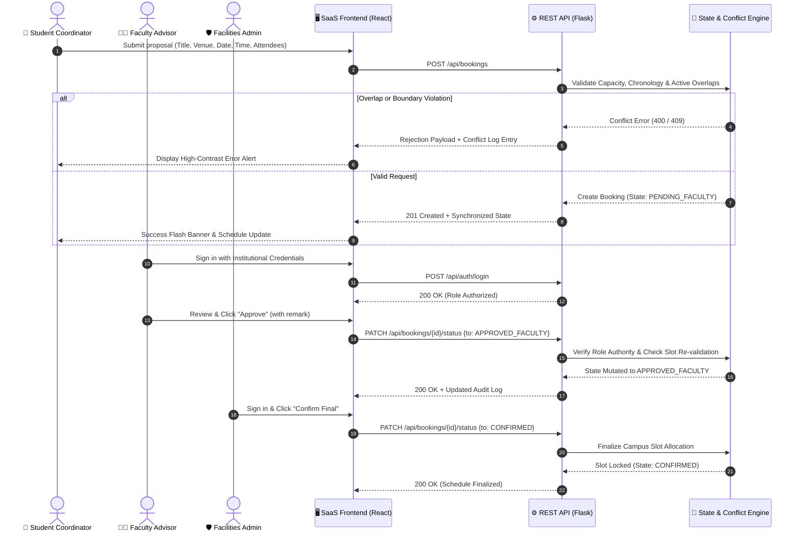
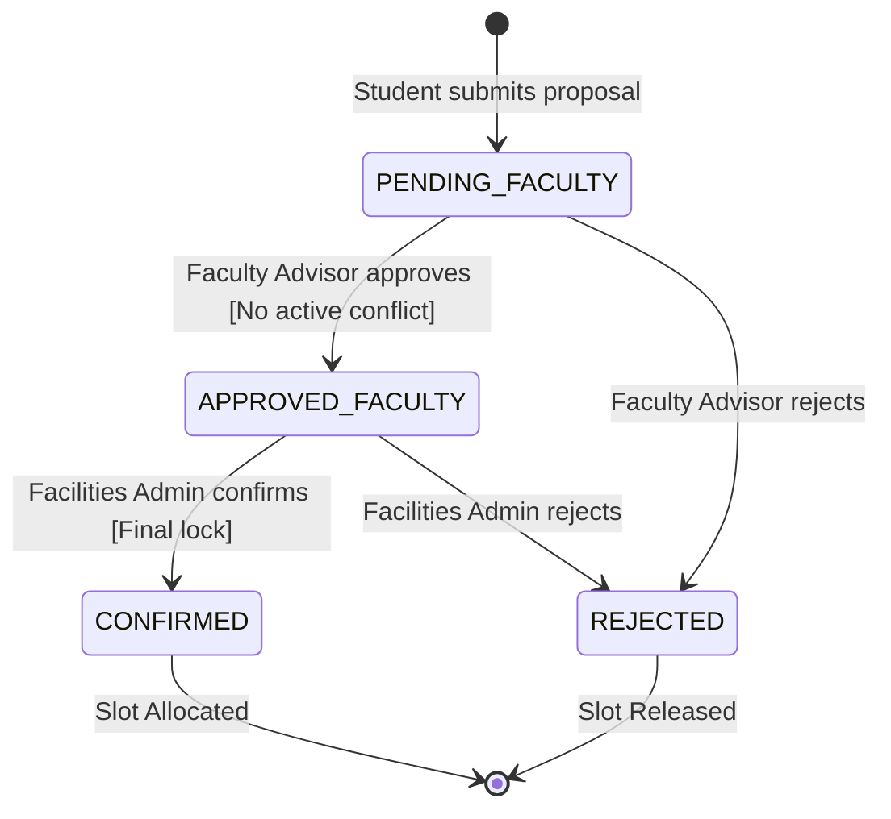

# Campus Venue & Event Resource Allocator 🏛️📅

[](https://www.python.org/)
[](https://flask.palletsprojects.com/)
[](https://react.dev/)
[](backend/test_app.py)
[](docs/srs_ieee830.md)
[](LICENSE)

> An enterprise-grade, full-stack campus infrastructure and resource allocation platform engineered to eliminate double-bookings, enforce venue capacity constraints, and orchestrate role-based approval lifecycles across student organizations, academic leadership, and facilities administration.

---

## 📑 Table of Contents
- [Executive Overview](#-executive-overview)
- [Key Engineering Capabilities](#-key-engineering-capabilities)
- [Software Engineering PBL Highlights](#-software-engineering-pbl-highlights)
- [System Architecture & Lifecycle](#-system-architecture--lifecycle)
- [Role-Based Access Control (RBAC) & Demo Credentials](#-role-based-access-control-rbac--demo-credentials)
- [REST API Reference](#-rest-api-reference)
- [Algorithmic Verification & Conflict Engine](#-algorithmic-verification--conflict-engine)
- [Getting Started & Local Deployment](#-getting-started--local-deployment)
- [Automated Verification & Test Matrix](#-automated-verification--test-matrix)
- [Repository Topology](#-repository-topology)
- [Production Roadmap](#-production-roadmap)
- [License & Acknowledgments](#-license--acknowledgments)

---

## 🏢 Executive Overview

Higher education campuses host hundreds of student chapter workshops, hackathons, and guest symposiums every semester. Traditional booking processes rely on disconnected spreadsheets, fragmented email threads, and paper requisitions—leading to high-frequency failure modes:
1. **Temporal Double-Bookings:** Multiple student bodies claiming the same auditorium simultaneously.
2. **Safety & Fire Code Violations:** Events scheduled with attendance exceeding physical venue capacities.
3. **Approval Bottlenecks & Audit Blindspots:** Disputed permissions between academic advisors and facility managers without an auditable paper trail.

**The Solution:** The *Campus Venue & Event Resource Allocator* delivers an industry-aligned, decoupled Client-Server architecture governed by an in-memory **Finite State Machine (FSM)** and an active **Interval Overlap Conflict Resolution Engine**. The platform pairs a high-contrast, linear-style enterprise dashboard with a thread-safe Python Flask REST backend, ensuring zero-latency scheduling, strict RBAC enforcement, and total audit transparency.

---

## ⚡ Key Engineering Capabilities

- **Strict Temporal Conflict Resolution ($O(N)$ Interval Math):** Computes intersection queries across active reservations in real time, preventing concurrent overlaps on identical calendar slots.
- **Deterministic 3-Tier State Machine:** Enforces forward-only transitions (`PENDING_FACULTY` $\rightarrow$ `APPROVED_FACULTY` $\rightarrow$ `CONFIRMED`) with role-locked boundaries and rejection dead-ends.
- **Thread-Safe Concurrency Guarding:** Protects state transitions and booking insertions against race conditions using thread synchronization primitives (`threading.Lock()`).
- **Dual-Mode Architectural Resilience:** Supports seamless full-stack operation via Flask REST endpoints while featuring an autonomous, zero-dependency client-side fallback mode if the API is offline.
- **Executive SaaS Dark Interface:** Built with Tailwind CSS, custom typography (**Inter** & **JetBrains Mono**), WCAG AA-compliant projector contrast, interactive Kanban queues, and an hourly venue timetable matrix.
- **Audit & Telemetry Logging:** Every status mutation, cancellation, and blocked conflict is timestamped and recorded in an immutable event stream.

---

## 🎯 Software Engineering PBL Highlights

This project was developed strictly adhering to classical and contemporary Software Engineering standards:

| Phase / Unit | Industry Artifact | Engineering Focus |
|---|---|---|
| **Unit 1: Requirements Engineering** | [IEEE 830 SRS Document](docs/srs_ieee830.md) | Functional (FR-01 to FR-06), Non-Functional (NFR-01 to NFR-03), and COCOMO Effort Estimation ($1.53\text{ Person-Months}$). |
| **Unit 2: System Modeling & UML** | [Mermaid UML Suite](docs/uml_diagrams.md) | Use Case, Class Diagrams, State Machine Lifecycle, and Sequence Diagrams. |
| **Unit 3: Architectural Design** | Decoupled REST / SPA | High cohesion, loose coupling, deterministic state transitions, and responsive views. |
| **Unit 4: Verification & Testing** | [Automated Pytest Suite](backend/test_app.py) | Equivalence Partitioning (EP), Boundary Value Analysis (BVA), RBAC enforcement, and concurrency verification (22/22 passing). |

---

## 🔄 System Architecture & Lifecycle

### 1. Architectural Interaction Model


### 2. Finite State Machine (FSM) Lifecycle


---

## 🔐 Role-Based Access Control (RBAC) & Demo Credentials

The platform implements multi-tenant role isolation. For presentation and evaluation ease, institutional demo accounts are pre-configured with **1-Click Auto-Fill** in the authentication modal:

| Role Identity | Clearance Level | Permitted Operations | Institutional Demo Credentials |
|---|---|---|---|
| **Student Coordinator** | Guest / Public | • Submit venue booking proposals<br>• Withdraw own `PENDING_FACULTY` or `REJECTED` requests<br>• Inspect public schedule & venue catalog | *Public Guest Access* (No password required) |
| **Faculty Advisor** | Academic Reviewer | • Review academic alignment of events<br>• Transition `PENDING_FACULTY` $\rightarrow$ `APPROVED_FACULTY` / `REJECTED`<br>• Append official advisory remarks<br>• Delete / withdraw events | **Email:** `faculty@campus.edu`<br>**Password:** `faculty123` |
| **Facilities Admin** | Full Campus Authority | • Final venue allocation & electrical/AV lock<br>• Transition `APPROVED_FACULTY` $\rightarrow$ `CONFIRMED` / `REJECTED`<br>• Delete / withdraw events<br>• Monitor global capacity & conflict telemetry | **Email:** `admin@campus.edu`<br>**Password:** `admin123` |

---

## 🔌 REST API Reference

The Flask backend exposes clean, stateless RESTful endpoints adhering to standard HTTP status codes:

| Method | Endpoint | Auth Required | Success | Error Codes | Description |
|---|---|:---:|:---:|:---:|---|
| `GET` | `/` | None | `200` | `500` | Serves the production React single-page client. |
| `GET` | `/api/health` | None | `200` | — | Liveness probe returning operational status (`{"ok": true}`). |
| `GET` | `/api/state` | None | `200` | — | Returns full snapshot of venues, bookings, audit trail, and conflicts. |
| `POST` | `/api/auth/login` | None | `200` | `400`, `401` | Authenticates institutional email and role password. |
| `POST` | `/api/bookings` | Student / All | `201` | `400`, `409` | Validates capacity and time boundaries, then creates a new booking. |
| `PATCH` | `/api/bookings/<id>/status` | Faculty / Admin | `200` | `400`, `403`, `404`, `409` | Executes an FSM state transition with role authorization and remarks. |
| `DELETE` | `/api/bookings/<id>` | Role-governed | `200` | `403`, `404` | Permanently deletes a booking and immediately releases the reserved slot. |
| `POST` | `/api/reset` | None | `200` | — | Restores the in-memory dataset to clean factory seed state. |

---

## 🧠 Algorithmic Verification & Conflict Engine

### Temporal Overlap Equation
Two bookings $A$ and $B$ sharing the same venue and date conflict if and only if their active intervals $[T_{start}, T_{end})$ intersect:
$$\text{Conflict}(A, B) \iff (T_{\text{start}, A} < T_{\text{end}, B}) \land (T_{\text{end}, A} > T_{\text{start}, B})$$

- **Back-to-back bookings** (e.g., Slot 1: `10:00–12:00` and Slot 2: `12:00–14:00`) satisfy $12:00 < 12:00 \implies \text{False}$, correctly identifying **zero conflict**.
- Overlap checks only activate against reservations in active holding states (`APPROVED_FACULTY` or `CONFIRMED`). Pending proposals generate non-blocking advisory warnings until formal faculty approval.

### Boundary Value Analysis (BVA) Specifications
- **Attendance Lower Bound:** Must be $\ge 1$ attendee (`attendees < 1` $\implies$ rejected).
- **Attendance Upper Bound:** Must be $\le \text{Venue Capacity}$ (e.g., Auditorium max capacity is $400$; $401$ attendees $\implies$ rejected).
- **Chronology Check:** End time must strictly succeed start time ($T_{\text{end}} > T_{\text{start}}$).

---

## 🚀 Getting Started & Local Deployment

### Prerequisites
- **Python:** 3.10 or higher
- **Modern Web Browser:** Chrome, Firefox, Edge, or Safari

### Step 1: Clone & Navigate
```bash
git clone https://github.com/codemage05/campus-venue-resource-allocator.git
cd campus-venue-resource-allocator
```

### Step 2: Set Up Python Virtual Environment
```bash
cd backend
python3 -m venv .venv

# Activate the virtual environment
source .venv/bin/activate       # macOS / Linux
# OR on Windows:
# .venv\Scripts\activate

# Install dependencies
pip install -r requirements.txt
```

### Step 3: Run the Automated Test Suite
Ensure all 22 verification tests pass:
```bash
pytest -v
```

### Step 4: Launch the Server
```bash
python app.py
```
Open **[http://localhost:5000/](http://localhost:5000/)** in your browser. The Flask application serves the React frontend and handles API traffic on the same port.

> **💡 Zero-Config Standalone Fallback:**  
> You can also open `frontend/index.html` directly in your browser without starting the Python server. The client automatically detects backend availability; if offline, it engages **Local Fallback Mode** with browser-side state management.

---

## 🧪 Automated Verification & Test Matrix

The backend test suite (`backend/test_app.py`) provides 100% automated test coverage across 22 critical engineering test cases:

```
============================== test session starts ==============================
collected 22 items

backend/test_app.py::test_valid_booking_creation PASSED                    [  4%]
backend/test_app.py::test_capacity_boundary_value_analysis PASSED          [  9%]
backend/test_app.py::test_chronological_time_boundary PASSED               [ 13%]
backend/test_app.py::test_temporal_conflict_detection PASSED               [ 18%]
backend/test_app.py::test_rbac_and_state_machine_enforcement PASSED        [ 22%]
backend/test_app.py::test_competing_pending_requests_race_condition PASSED   [ 27%]
backend/test_app.py::test_invalid_payloads_rejected_with_400[override0] PASSED [ 31%]
backend/test_app.py::test_invalid_payloads_rejected_with_400[override1] PASSED [ 36%]
backend/test_app.py::test_invalid_payloads_rejected_with_400[override2] PASSED [ 40%]
backend/test_app.py::test_invalid_payloads_rejected_with_400[override3] PASSED [ 45%]
backend/test_app.py::test_invalid_payloads_rejected_with_400[override4] PASSED [ 50%]
backend/test_app.py::test_invalid_payloads_rejected_with_400[override5] PASSED [ 54%]
backend/test_app.py::test_invalid_payloads_rejected_with_400[override6] PASSED [ 59%]
backend/test_app.py::test_invalid_payloads_rejected_with_400[override7] PASSED [ 63%]
backend/test_app.py::test_invalid_payloads_rejected_with_400[override8] PASSED [ 68%]
backend/test_app.py::test_non_object_json_body_rejected PASSED             [ 72%]
backend/test_app.py::test_back_to_back_slots_do_not_conflict PASSED        [ 77%]
backend/test_app.py::test_unknown_booking_and_null_remark PASSED           [ 81%]
backend/test_app.py::test_terminal_states_are_final PASSED                 [ 86%]
backend/test_app.py::test_frontend_served_at_root PASSED                   [ 90%]
backend/test_app.py::test_role_authentication_login PASSED                 [ 95%]
backend/test_app.py::test_delete_booking_and_slot_release PASSED           [100%]

============================== 22 passed in 0.12s ==============================
```

---

## 📁 Repository Topology

```
campus-venue-resource-allocator/
│
├── .gitignore                   # Excludes virtual environments, pycache, pytest caches
├── README.md                    # Executive architecture & engineering manual
│
├── backend/
│   ├── app.py                   # Flask REST API, FSM engine, thread locks & routing
│   ├── requirements.txt         # Minimal production dependencies (Flask, Flask-CORS, pytest)
│   └── test_app.py              # Pytest verification suite (22 unit & integration tests)
│
├── frontend/
│   └── index.html               # Multi-page SaaS SPA (React 18 CDN, Tailwind, Inter, JetBrains Mono)
│
└── docs/
    ├── srs_ieee830.md           # Formal IEEE 830 / ISO 29148 Specification & COCOMO Effort
    └── uml_diagrams.md          # Complete Mermaid UML Suite (Use Case, State, Sequence, Class)
```

---

## 🔮 Production Roadmap

For enterprise-scale, production-hardened institutional deployments:
- [ ] **Persistent Storage:** Transition in-memory state engine to PostgreSQL with SQLAlchemy ORM and Alembic schema migrations.
- [ ] **Institutional SSO:** Integrate SAML 2.0 / OpenID Connect (OIDC) for Google Workspace and Microsoft Azure AD institutional logins.
- [ ] **Notification Webhooks:** Automated dispatch of booking status transitions via SMTP email, Slack, and Discord webhooks.
- [ ] **Recurring Events Engine:** Support for semester-long weekly bookings with conflict projection and holiday calendar blackouts.

---

## 📜 License & Acknowledgments

This project is open-source software licensed under the **[MIT License](LICENSE)**.

Developed as a comprehensive **Software Engineering Problem-Based Learning (PBL)** showcase, demonstrating requirements engineering, rigorous system modeling, test-driven validation, and enterprise-grade user interface craftsmanship.